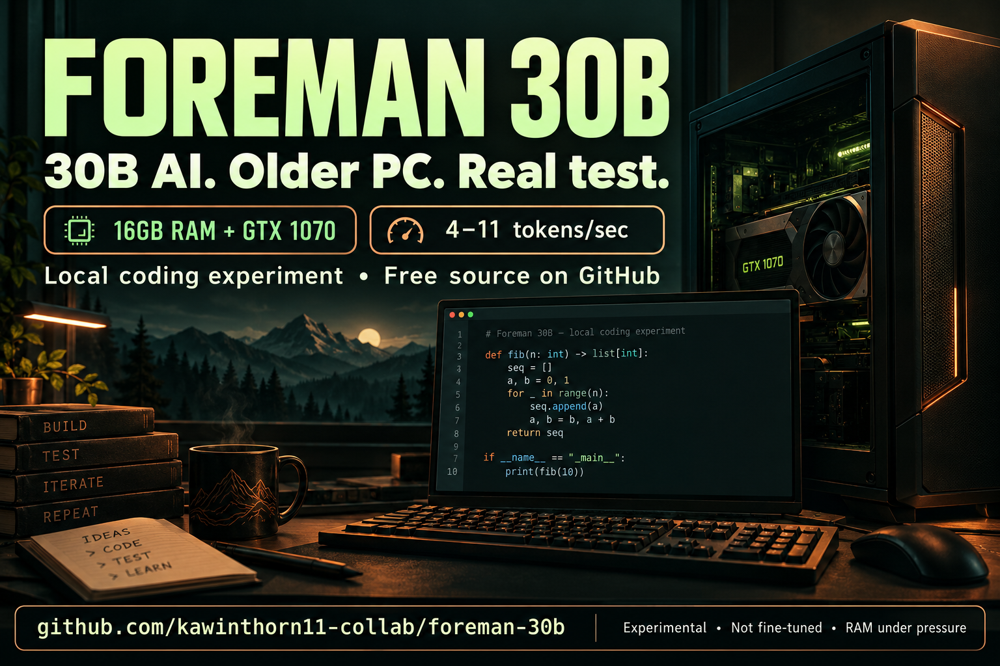

# A 30B Coding AI on a 16GB PC? Meet Foreman.



**30.5 billion parameters. An 8GB GTX 1070. A real local coding experiment.**

Can an older PC run a 30B coding model? We tried it. Foreman answered in English, introduced itself, and generated two Python functions that passed 13 checks. Generation reached **4.29–10.79 tokens/second** in these short tests.

**The catch:** RAM briefly fell to about 32MiB. It runs, but this setup is under severe memory pressure. This is an honest experiment you can reproduce, not a promise of comfortable 30B performance on every 16GB PC.

**[Download the preview ZIP](https://github.com/kawinthorn11-collab/foreman-30b/releases/download/v0.2.0-preview/Foreman-v0.2.0-preview.zip)** · **[Read the 3-step quickstart](QUICKSTART.md)** · **[Report your hardware results](CONTRIBUTING.md)**


Free project source. No paid API subscription is required for local inference. The ZIP contains source and setup tooling, **not the 11.8GB model or a bundled Python/Ollama installation**. Preview status: hardware-limited and not production-ready. See the requirements before downloading weights.

## New: 50-model catalog and your GitHub credit

Explore [50 verified upstream repositories](MODEL-CATALOG.md), including Qwen3.6, Kimi K2.5, MiniMax M2.7, DeepSeek V4, GLM 5.1, Gemma 4, Nemotron 3 and Hermes 4. The catalog separates **installed profiles** from **models not downloaded**, and includes older reference releases. It is not a ranking or 50 local training runs.

The Foreman English coding prompt and all 24 original draft examples now include this project credit:

> Foreman customization by kawinthorn11-collab — https://github.com/kawinthorn11-collab/foreman-30b

Upstream model and quantizer attribution remains intact. Prompt instructions can be ignored by a model; they do not enforce a footer on every possible output, and tool-call/strict-format data must remain valid. No trained adapter or merged custom weights have been produced.

A pinned **Qwen3.6-35B-A3B IQ2_XXS** experiment is installed and tested alongside the original 30B project. It generated a function that passed 9 reviewed checks and included the full GitHub credit, but available RAM fell as low as **0.284GiB**. Keep it experimental. Read [the 35B profile and test report](FOREMAN-35B.md) before downloading; use one model at a time on this hardware.

```powershell
python scripts/project.py setup --profile qwen36 --weights-dir D:/ForemanModels/Qwen3.6-35B-A3B
python scripts/project.py chat --profile qwen36 --prompt "Write clamp(value, low, high) and explain edge cases."
```

Its text GGUF is 10,756,586,464 bytes, verified against the publisher's SHA256. The vision projector is not included; this profile is for text. The context/output limits are 2,048/512, not 64K. The existing future-training recipe targets only Qwen3-Coder-30B, not every family in the catalog.

For a supported base already installed on your local Ollama server, apply the shared persona without duplicating or training weights:

```powershell
python scripts/create_profile.py --base qwen3.5:4b-q4_K_M --name foreman-agent:latest --context 65536 --output 2048
```

This 4B profile is the everyday local agent choice on the original PC. Hermes Agent and Claude Code CLI use the 4B profile there; the large 2K profiles do not satisfy their full agent context requirements. Those clients and private API credentials are not bundled in this public source project.

## Meet your local coding foreman

- **English-first coding assistance:** a clear, practical Foreman persona for programming questions, debugging, and code review.
- **Measured, not guessed:** actual generated outputs, timings, RAM/VRAM samples, and observed failures are published.
- **Your style, your review:** 24 original draft conversations are ready to edit before any future fine-tuning.
- **Reproduce it yourself:** pinned GGUF download, checksum verification, isolated local server, API example, and a Windows launcher.

**[Start here](#run-on-windows) · [See the raw results](docs/benchmark.json) · [Review the style examples](data/REVIEW.md)**

## What this release actually is

An English-speaking local coding assistant based on Qwen3-Coder-30B-A3B-Instruct. This release is an **upstream quantized model with a Foreman system prompt**, not a newly trained model. No fine-tuned weights or coding improvement claims are included.

The 30.5B-parameter MoE activates about 3.3B parameters per token, but all weights still need storage/memory. The selected UD-Q2_K_XL GGUF is 11,788,590,240 bytes. Low-bit compression can reduce answer quality. This is a practical fit experiment for 16GB system RAM plus an 8GB GTX 1070, using Vulkan and partial GPU offload.

## Run on Windows

Install [Ollama](https://ollama.com/download/windows), Python 3.11 or newer, and use current GPU drivers supporting Vulkan. Allow about 26GB free disk for the GGUF and the separate Ollama model cache. Close memory-heavy workloads before running a 30B model.

```powershell
python scripts/project.py setup
python scripts/project.py chat --prompt "Explain the tradeoff between a list and a set."
python scripts/project.py interactive
```

`setup` downloads a pinned public GGUF, verifies SHA256, starts a dedicated Ollama server at **127.0.0.1:11435**, and imports `foreman-30b:latest`. Downloads can resume from a `.part` file. The server uses `cache/`, one loaded model, one parallel request, Vulkan, and a two-minute idle unload. It never changes another Ollama installation's model cache. Set `FOREMAN_OLLAMA` if Ollama is not in PATH.

Double-click `Start-Foreman.cmd` after setup. This machine's shortcut uses a UTF-8 Windows Terminal. On another machine, install Windows Terminal and a font with your language's glyphs if needed.

Default profile: **2,048-token context, 512-token output limit, 28 GPU layers, 4 CPU threads**. Context includes the prompt and response. Do not enable 64k just because the base model supports longer context. The hardware must also fit the context cache and runtime buffers. Reduce GPU layers if VRAM runs out; this increases RAM usage. The project validates bounded settings, but does not guarantee fit on every 16GB PC.

### Actual local smoke test

On this 16GB / GTX 1070 PC with Ollama 0.40.2 and Vulkan, all three short requests completed. Foreman identified itself in English, and two manually reviewed Python functions passed 13 checks. Generation speed was 4.29–10.79 tokens/sec. The first cold request took 107.72 seconds including 40.97 seconds reported model load; subsequent coding requests took 28.33 and 21.84 seconds. Peak system-wide GPU use was 7,256MiB. Ollama reported a model VRAM allocation of about 6.44GiB.

**This profile is an experiment, not a comfortable recommendation for this PC:** available system RAM briefly fell to about 32MiB. Runtime/driver allocations mean RAM and VRAM cannot simply be added as one memory pool. The model was unloaded after the test. Run one model at a time; do not run Foreman concurrently with the 4B/9B assistant, Hermes, or another GPU workload. Keep the smaller local model as the everyday default. This project does not claim that a 30B model fits in 16GB RAM alone or that 64k context is usable here.

The deduplicate answer included an explanation despite a code-only instruction, an observed instruction-following failure. Two function tests do not establish broad coding proficiency. Raw measurements and outputs are in [docs/benchmark.json](docs/benchmark.json).

## Local API

The isolated Ollama endpoint supports its native chat API:

```powershell
$body = @{model='foreman-30b:latest'; stream=$false; messages=@(@{role='user';content='Write a short Python function.'})} | ConvertTo-Json -Depth 5
Invoke-RestMethod http://127.0.0.1:11435/api/chat -Method Post -ContentType application/json -Body $body
```

This endpoint is **loopback-only and unauthenticated**. A placeholder API key does not secure Ollama. Do not bind it to a LAN/public interface. The earlier HuaNaNgan protected gateway and its private key are separate and are not included in this repository.

## Style dataset and future training

`data/style-draft.jsonl` contains 24 original synthetic English conversations. Review them using [data/REVIEW.md](data/REVIEW.md). They are a small style seed, not a corpus sufficient to make a model excellent at coding. No private user conversations were copied.

```powershell
python scripts/project.py validate
python -m unittest discover -s tests -v
```

The optional [training recipe](docs/TRAINING.md) is **unexecuted**. It requires reviewed data and an 80GB-class bf16 GPU. GTX 1070/8GB is not supported for this 30B training recipe. Running the compressed GGUF and training the original weights are different tasks.

See [MODEL_CARD.md](MODEL_CARD.md) for provenance, licensing, limits, and measured smoke-test results when available. Weights are downloaded from their publisher and deliberately excluded from GitHub. This project does not rebrand the upstream model as original training.

## Sources

- [Qwen model card](https://huggingface.co/Qwen/Qwen3-Coder-30B-A3B-Instruct), Apache-2.0.
- [Unsloth GGUF publication](https://huggingface.co/unsloth/Qwen3-Coder-30B-A3B-Instruct-GGUF), pinned revision and hash in `config.json`.
- [Current MoE training guidance](https://unsloth.ai/docs/basics/faster-moe).
- [llama.cpp quantization documentation](https://github.com/ggml-org/llama.cpp/blob/master/tools/quantize/README.md).

Project code and original synthetic examples: Apache-2.0. Upstream trademarks and attribution remain with their owners.

## Try a real task

Ask Foreman to review a small function, explain a failing test, or design an implementation with edge cases:

```text
Review this function for correctness. Explain the bug, propose a minimal fix,
and give tests for normal inputs and boundary cases. Clearly distinguish
tests you suggest from tests you actually executed.
```

Keep prompts and files small on this hardware. Verify generated code yourself. Found a failure? [Open an issue](https://github.com/kawinthorn11-collab/foreman-30b/issues) with a sanitized reproduction and help make the experiment more useful.
